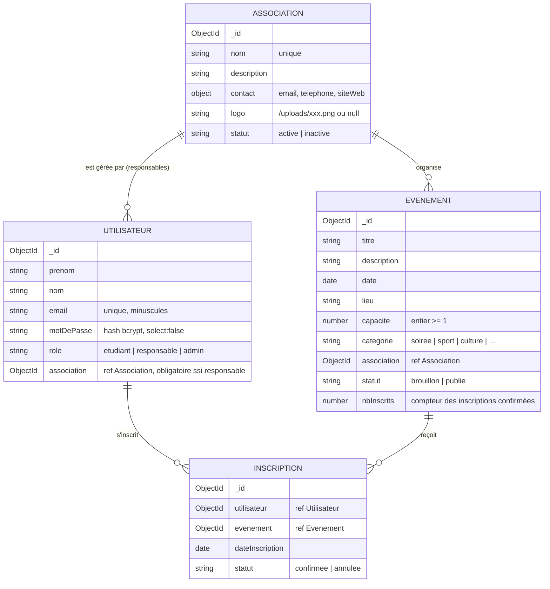

# Modèle de données (MongoDB / Mongoose)

## Schéma relationnel



Toutes les collections ont aussi `createdAt` / `updatedAt` (option `timestamps`).

## Relations et leur exploitation

| Relation | Type | Modélisation | Où elle est exploitée |
|---|---|---|---|
| Association → Événements | 1–N | `Evenement.association` (référence) + virtuel `Association.evenements` | Fiche association, filtre par association, `populate('association')` sur les listes |
| Association → Responsables | 1–N | `Utilisateur.association` | Droits : un responsable ne gère que les données de « son » association |
| Utilisateur ↔ Événement | N–N | Collection de liaison `Inscription` | Mes inscriptions, liste des inscrits, export CSV |

**Pourquoi des références plutôt que des sous-documents ?** Les inscriptions sont nombreuses, modifiées
indépendamment, et consultées dans les deux sens (par utilisateur et par événement) : une collection de
liaison avec index est plus adaptée qu'un tableau imbriqué qui grossirait sans limite.

## Index

| Collection | Index | Rôle |
|---|---|---|
| utilisateurs | `{ email: 1 }` unique | Pas deux comptes avec le même email |
| associations | `{ nom: 1 }` unique | Pas deux associations du même nom |
| evenements | `{ statut: 1, date: 1 }` | Liste publique (publiés, triés par date) |
| evenements | `{ association: 1 }` | Événements d'une association |
| inscriptions | `{ utilisateur: 1, evenement: 1 }` **unique** | Règle « pas de double inscription », garantie par la base |
| inscriptions | `{ evenement: 1 }` | Liste des inscrits |

## Validations Mongoose

- Champs obligatoires avec messages en français, longueurs maximales, formats (email, téléphone, URL du site, chemin du logo).
- `capacite` : entier ≥ 1 et **≥ `nbInscrits`** (validateur personnalisé).
- `Utilisateur.association` : obligatoire si `role = responsable`, interdite sinon (validation croisée).
- `motDePasse` : 8 caractères minimum, validé **avant** le hachage (le hook `pre('save')` hache ensuite).
- `toJSON` de l'utilisateur supprime toujours `motDePasse`.

## Le compteur `nbInscrits` (dénormalisation assumée)

Compter les inscriptions puis insérer (« s'il reste de la place, j'inscris ») n'est pas sûr : deux requêtes
simultanées peuvent lire « 1 place restante » en même temps et toutes deux s'inscrire.

On stocke donc le nombre d'inscriptions confirmées dans l'événement et on réserve une place en **une seule
opération atomique** :

```ts
Evenement.findOneAndUpdate(
  { _id, statut: 'publie', $expr: { $lt: ['$nbInscrits', '$capacite'] } },
  { $inc: { nbInscrits: 1 } }
);
```

Si le résultat est `null`, l'événement est complet. Si la création de l'inscription échoue ensuite
(ex. doublon), la place est rendue (compensation). Un test lance 25 inscriptions simultanées sur
5 places et vérifie qu'exactement 5 réussissent.
